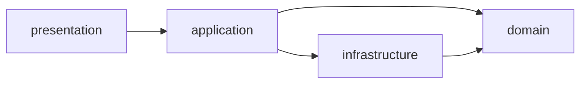

# FIAP Bank - CP5 Domain Driven Design / Java

**Entrega individual:** Matheus Bispo Faria Barbosa - **RM562140**

**Turma:** 2ESPH | **Professor:** Eduardo dos Santos Ramos

Monorepo com Core Bancário, Plataforma de Crédito, Mesa de Operações e Internet Banking Mobile.
Java 21, Spring Boot 4.1.1, Spring Cloud 2025.1.3, Maven e Angular 17.

## Executar e validar

Pré-requisitos: JDK 21 (`JAVA_HOME`), Maven, Node/npm e Chrome para os testes Angular.
A validação desta entrega usou Java 21.0.12.1, Maven 3.9.16, Node 24.18.0 e Chrome Headless.
O Angular 17 foi mantido para preservar o frontend fornecido; não foi feita migração de versão.

Na raiz do repositório, compile e teste os três serviços:

```powershell
mvn -f fiap-bank-core-bancario/pom.xml clean verify
mvn -f fiap-bank-plataforma-credito/pom.xml clean verify
mvn -f fiap-bank-mesa-operacoes-credito/pom.xml clean verify
```

Para preparar e testar o frontend:

```powershell
cd fiap-bank-internet-banking-mobile
npm ci
npm test -- --watch=false --browsers=ChromeHeadless
npm run build
cd ..
```

Depois, inicie cada aplicação em um terminal separado:

```powershell
java -jar fiap-bank-core-bancario/presentation/target/presentation-1.0.0-SNAPSHOT.jar
java -jar fiap-bank-plataforma-credito/presentation/target/presentation-1.0.0-SNAPSHOT.jar
java -jar fiap-bank-mesa-operacoes-credito/target/fiap-bank-mesa-operacoes-credito-1.0.0-SNAPSHOT.jar
cd fiap-bank-internet-banking-mobile
npm start
```

| Aplicação | Padrão local preservado | Perfil `enunciado` |
|---|---:|---:|
| Core Bancário | 8081 | 8080 |
| Plataforma de Crédito | 8080 | 8081 |
| Mesa de Operações | 8082 | 8082 |
| Internet Banking | 4200 | 4200 |

**Para a avaliação, use o perfil `enunciado`**, pois a seção 4 pede Core em 8080.
Acrescente `--spring.profiles.active=enunciado` a cada comando Java e execute
`npm start -- --configuration enunciado` no Angular. As quatro aplicações devem usar o mesmo perfil.
O padrão local mantém Core em 8081 conforme a integração já existente.

Configurações carregadas pelos executáveis:

- Core: `presentation/src/main/resources/application.properties`.
- Plataforma: `presentation/src/main/resources/application.yml`.
- Mesa: `src/main/resources/application.yml`.
- Angular: `src/assets/config/app-config.json`; perfil do enunciado em `src/config-enunciado/app-config.json`.

## Arquitetura

Core e Plataforma têm exatamente quatro módulos físicos. Os `domain` não têm dependências externas.



`presentation` publica DTOs e delega casos de uso; `application` orquestra transações;
`infrastructure` contém entidades JPA, Spring Data, adapters e clientes de integração;
`domain` contém entidades, repositórios abstratos e regras puras.
O Core utiliza os objetos de valor `Cpf`, `Email` e `Saldo`, além dos enums de conta.
O motor de concessão da Plataforma está no domínio puro. Lombok reduz o código repetitivo das entidades JPA dos dois backends.

A fase Maven `validate` executa Enforcer para proibir dependências diretas entre módulos não autorizados
e análise estática para rejeitar referências de código a camadas proibidas. Não se usa apenas convenção de pastas.
Os identificadores públicos existentes continuam `Long` e os DTOs preservam `ativa`, mantendo os contratos já implementados;
isso difere do UUID e de parte da representação de status no diagrama conceitual do PDF.

## APIs REST e compatibilidade

Core, sob `/api/v1`:

- `GET /clientes`, `GET /clientes/{id}`, `GET /clientes/cpf/{cpf}`.
- `POST /clientes` (201), `PUT /clientes/{id}` (200), `DELETE /clientes/{id}` (204).
- `GET /contas`, `GET /contas/{numeroConta}`, `GET /contas/cliente/{cpf}`.
- `POST /contas` (201), `PUT /contas/{numeroConta}/saldo` (200), `DELETE /contas/{numeroConta}` (204).

Plataforma:

- `POST /api/v1/creditos` (201), `GET /api/v1/creditos`.
- `GET /api/v1/creditos/{id}`, `GET /api/v1/creditos/cliente/{cpf}`.
- `PUT /api/v1/creditos/{id}/status`, corpo `{"status":"APROVADO","parecerOperador":"OK"}`
  ou `{"status":"REPROVADO","parecerOperador":"Motivo"}`.

O controller adaptador preserva os sete POST legados em `/api/credito`:
`solicitarCredito`, `consultarStatusCredito`, `buscarSolicitacaoPorId`, `listarTodasSolicitacoes`,
`aprovarSolicitacao`, `reprovarSolicitacao`, `consultarClienteCore`.
Os dois contratos usam os mesmos serviços e a mesma persistência.
As antigas rotas intermediárias PATCH com `/aprovar` e `/reprovar` foram substituídas pelo recurso REST `/status`;
os frontends fornecidos utilizam os POST legados, preservados.

Bean Validation e `@RestControllerAdvice` tratam entradas inválidas (400), inexistência (404)
e conflitos de negócio no Core (409). Uma proposta finalizada não pode receber uma decisão contraditória.

## Dados e limitações reais

O H2 é **em memória**: reiniciar os processos apaga os dados. O Core inicia vazio; os registros criados manualmente
em uma sessão anterior não são dados permanentes. A Plataforma pré-carrega três propostas demonstrativas.
Para criar uma conta, cadastre primeiro o cliente pela API REST e depois a conta com seu CPF.

`POST /api/credito/consultarClienteCore` consulta o Core por Feign e preserva `statusConta`, `saldo`, `agencia`, `numeroConta`:
conta ativa tem prioridade; conta inativa conserva o saldo; 404/lista vazia resulta em `SEM_CONTA`;
falha de rede ou do serviço resulta em `INDISPONIVEL`. A API legada mantém HTTP 200 com esse status funcional.
Há timeouts de conexão e leitura para não aguardar indefinidamente.

SCR e Bureau são simulações determinísticas; CRM devolve ausência de histórico simulado;
notificações são registradas no console. Não há integração com serviços financeiros externos reais.
A aprovação **não realiza desembolso automático no Core**: essa etapa do cenário de negócio permanece pendente.
A consulta ao Core é informativa e não bloqueia a concessão. Não há autenticação, autorização ou garantias de processamento financeiro distribuído.
O extrato do Angular é demonstrativo, identificado na tela; o saldo vem exclusivamente do Core.
A simulação visual com juros é ilustrativa; a política acadêmica analisa valor dividido por parcelas e limite de 30% da renda.

## Evidências e entrega

- [Validação e rubrica](docs/VALIDACAO_CP5.md).
- [Cartão-resposta em texto](docs/AVALIACAO_TEORICA.md).
- [Cartão-resposta em PDF](docs/RM562140_Matheus_Bispo_Faria_Barbosa_CP5_Cartao_Resposta.pdf).

A entrega no Teams exige PDF, ZIP e link do GitHub. O PDF menciona uma tarefa denominada "Checkpoint 4"
na seção de entrega do CP5; conferir o nome efetivo da tarefa no Teams. A origem como fork de `prof-eduardo-ramos/fiap-esp-cp5-ddd-java` foi confirmada pela API pública do GitHub. Publicação remota e submissão no Teams não fazem parte dos testes locais.
O uso de IA apoiou revisão, testes e documentação; o aluno deve revisar as respostas e dominar os conceitos para a defesa.
